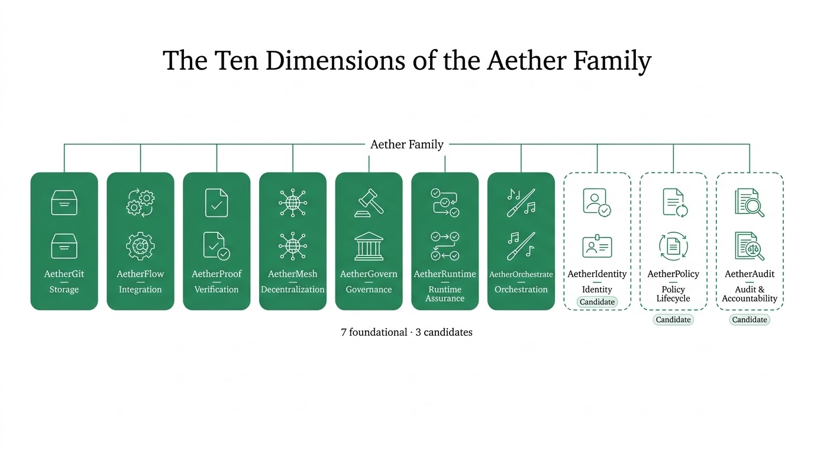
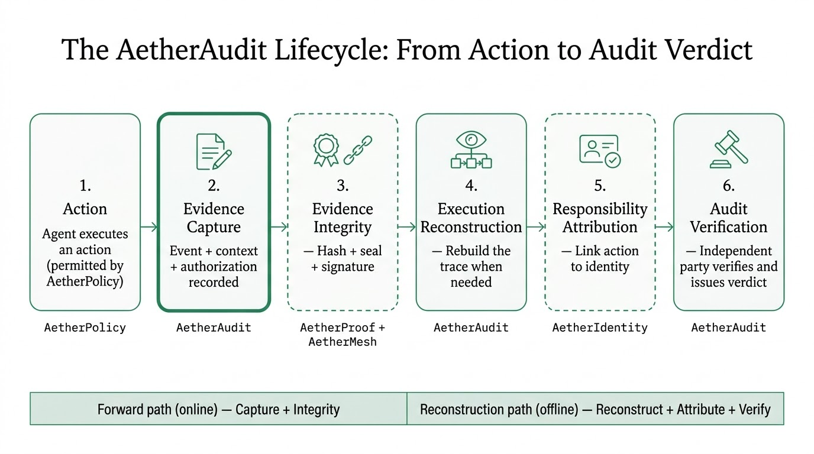
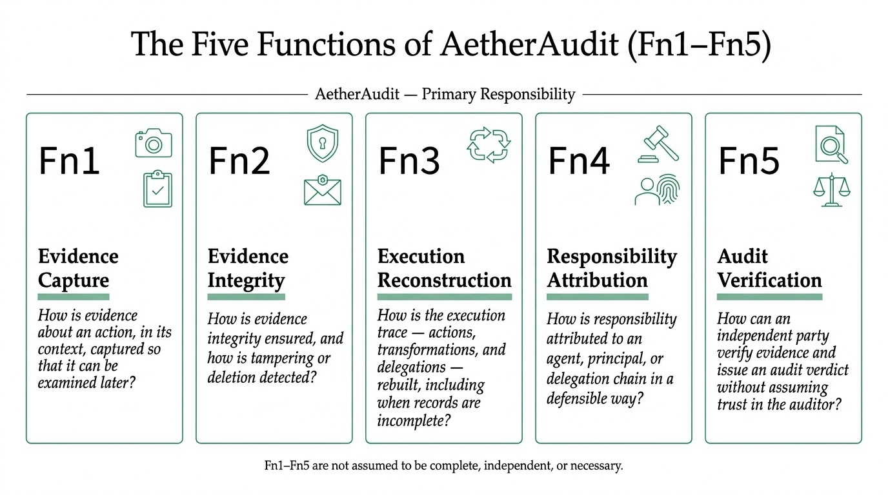
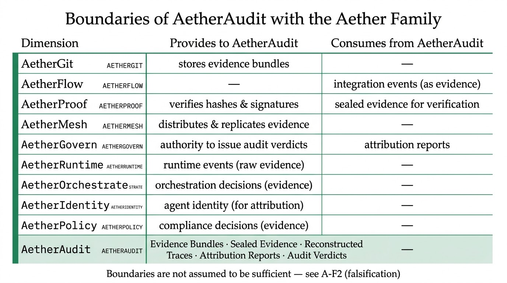
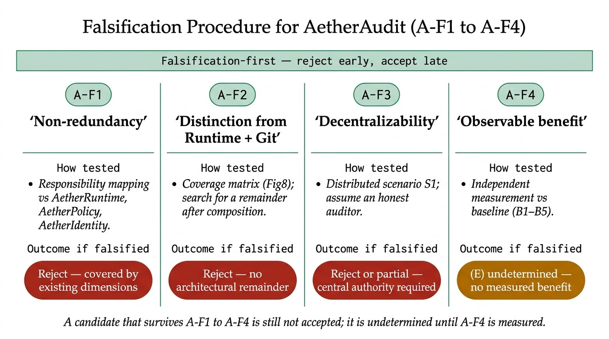
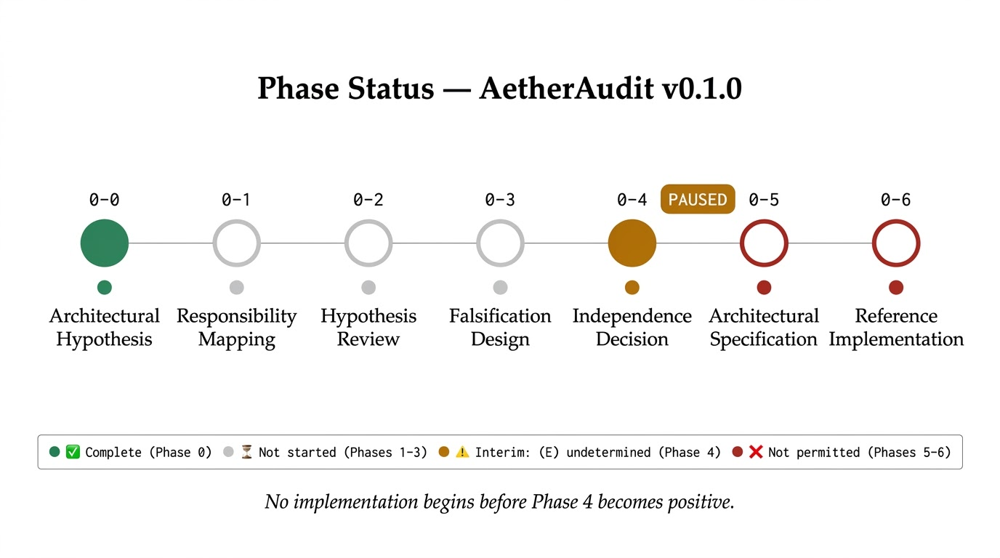
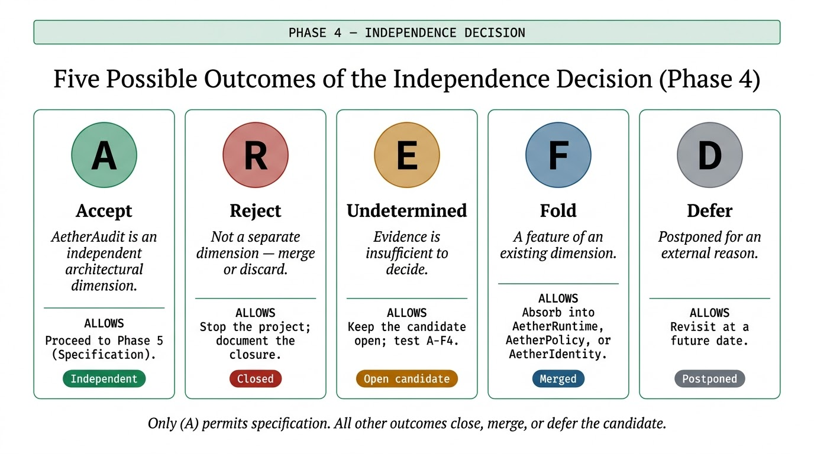
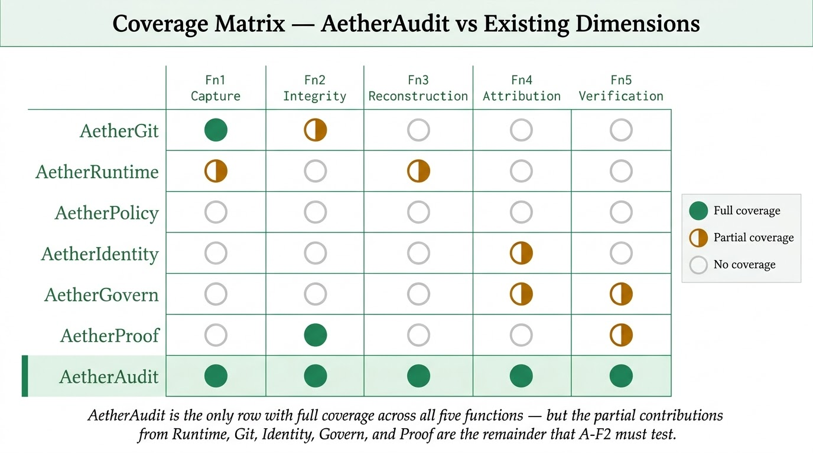
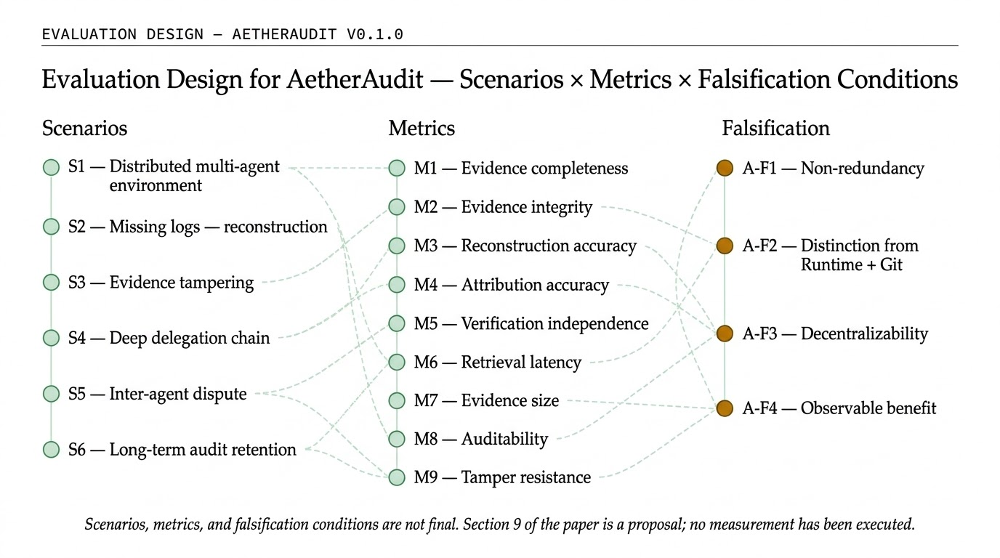

# AetherAudit — Architectural Hypothesis

**Status:** Hypothesis under investigation. Not a committed project.
**Position in the Aether family:** Tenth project (candidate).
**Date:** 2026-11-16
**Version:** 1.0.0
**Author:** Samir Baladi
**ORCID:** [0009-0003-8903-0029](https://orcid.org/0009-0003-8903-0029)
**License:** CC-BY-4.0 (this document)

---

## 0. Status of this document

This document states a hypothesis. It does **not** state a result.

- It does **not** claim that AetherAudit is an independent architectural dimension.
- It does **not** claim that the gap it describes is genuine.
- It does **not** claim that the boundaries with AetherRuntime, AetherPolicy, AetherIdentity, and the other dimensions are sufficient.
- It does **not** authorize implementation.

The next steps are: review of this hypothesis, review of the responsibility boundaries, definition of falsification conditions, and a decision on architectural independence. Only after that decision may specification or implementation begin.

---

## 1. Position in the Aether family

The Aether family currently has **seven foundational dimensions** and **three candidates** (including AetherAudit):

| # | Project | Status |
|---|---|---|
| 1 | AetherGit | Foundational |
| 2 | AetherFlow | Foundational |
| 3 | AetherProof | Foundational |
| 4 | AetherMesh | Foundational |
| 5 | AetherGovern | Foundational |
| 6 | AetherRuntime | Foundational |
| 7 | AetherOrchestrate | Foundational |
| 8 | AetherIdentity | Candidate (paper + v2.0.0; independence not settled) |
| 9 | AetherPolicy | Candidate (Phase 4: undetermined) |
| 10 | **AetherAudit** | **Candidate (this document; not yet studied)** |

AetherAudit is the **tenth project**. It is **not** a replacement for AetherIdentity or AetherPolicy, and it does **not** renumber either. Both remain candidates with unresolved independence.

---

## 2. Central question

> **How can operational evidence be produced, kept intact, and used to reconstruct what actually happened and attribute responsibility — in decentralized autonomous agent systems — independently of runtime monitoring and policy enforcement?**

This is the initial central question. It is subject to revision after the hypothesis review.

The question carries four clauses:

| Clause | Condition |
|---|---|
| (i) Not already covered by monitoring or policy | A-F1 |
| (ii) Does not decompose into AetherRuntime + AetherGit | A-F2 |
| (iii) No central audit authority | A-F3 |
| (iv) Observable benefit | A-F4 |

---

## 3. Five functions (initial scope)

The following five functions are proposed as the **initial scope**. They are not final requirements. Each is subject to falsification.

| # | Function | Question |
|---|---|---|
| Fn1 | **Evidence Capture** | How is evidence about an action, in its context, captured so that it can be examined later? |
| Fn2 | **Evidence Integrity** | How is evidence integrity ensured, and how is tampering or deletion detected? |
| Fn3 | **Execution Reconstruction** | How is the execution trace — actions, transformations, and delegations — rebuilt, including when records are incomplete? |
| Fn4 | **Responsibility Attribution** | How is responsibility attributed to an agent, principal, or delegation chain in a defensible way? |
| Fn5 | **Audit Verification** | How can an independent party verify evidence and issue an audit verdict without assuming trust in the auditor? |

These five are **not** assumed to be complete, independent, or necessary. A later phase may drop one, merge two, or add a sixth.

---

## 4. Architectural hypothesis

> **A potentially independent architectural gap may exist between runtime monitoring, policy enforcement, and identity: the operational management of audit evidence — its capture, integrity, reconstruction, attribution, and independent verification — across decentralized autonomous agents.**

This is a hypothesis. It is stated so that it can fail. Specifically:

- If **AetherRuntime** already provides all audit requirements without an additional layer, the gap is not independent.
- If **AetherGit plus runtime logs plus policy decisions** cover the five functions with bounded integration, the gap is not independent.
- If **no independent properties** of evidence integrity, reconstruction, or attribution exist, the gap is not independent.
- If the candidate is only an **aggregation of existing logs under a unified interface**, the gap is not independent.
- If a **central audit authority** is required, decentralizability (A-F3) fails.
- If no **observable benefit** is demonstrated, A-F4 fails.

The hypothesis is falsified if any of the above holds.

---

## 5. Boundaries with the Aether family

The following boundaries are the **initial points of contact**. They are not assumed to be sufficient.

### 5.1 With the seven foundational dimensions

| Dimension | Responsibility | AetherAudit's relation |
|---|---|---|
| **AetherGit** | Storage and versioning | AetherAudit consumes evidence storage; it does not store source |
| **AetherFlow** | Integration | AetherAudit records integration events as evidence; it does not integrate |
| **AetherProof** | Verification | AetherAudit consumes verification primitives; it does not replace AetherProof |
| **AetherMesh** | Decentralization | AetherAudit relies on AetherMesh for distribution; it does not distribute itself |
| **AetherGovern** | Governance authority | AetherAudit consumes authority to issue verdicts; it does not issue it |
| **AetherRuntime** | Runtime assurance | AetherAudit consumes runtime observations as evidence; it does not monitor |
| **AetherOrchestrate** | Orchestration | AetherAudit records orchestration decisions as evidence; it does not orchestrate |

### 5.2 With the two candidates

| Dimension | Responsibility | AetherAudit's relation |
|---|---|---|
| **AetherIdentity** | Determination of agent identity | AetherAudit uses identity to attribute responsibility; it does not determine identity |
| **AetherPolicy** | Policy evaluation and enforcement | AetherAudit records compliance decisions as evidence; it does not evaluate policy |

### 5.3 Boundaries are not assumed sufficient

The boundaries are **not assumed to be sufficient**. A later phase must analyze whether:

- AetherRuntime's monitoring already covers the audit requirements.
- AetherGit's storage and runtime logs already cover the five functions.
- AetherProof's verification already covers evidence integrity.
- AetherGovern's authority already covers audit verdicts.
- The boundaries overlap in ways that make AetherAudit a feature, not a dimension.

---

## 6. Falsification-first methodology

AetherAudit follows the same falsification-first methodology as AetherPolicy:

1. **Architectural Hypothesis** (this document).
2. **Responsibility Mapping** — boundaries with the existing dimensions.
3. **Hypothesis Review** — independent review of the hypothesis and the boundaries.
4. **Falsification Design** — specific conditions under which AetherAudit does not deserve to be a separate dimension.
5. **Independence Decision** — a decision on whether the candidate is independent.
6. **Specification** — only if the independence decision is positive.
7. **Implementation** — only after specification.
8. **Evaluation** — only after implementation.

**No implementation begins before step 5.**

The falsification conditions will be designed **for AetherAudit**, not copied from AetherPolicy's P-F1–P-F5. They will address:

- Whether the five functions are already covered by AetherRuntime, AetherPolicy, AetherIdentity, or a bounded extension of one of them.
- Whether evidence integrity and reconstruction can be reduced to existing verification or storage mechanisms.
- Whether audit verification requires a central authority or a trust anchor.
- Whether AetherAudit yields an observable benefit over existing mechanisms.

These are **directions**, not final conditions. The final conditions are set in step 4.

---

## 7. What this document does not claim

- That AetherAudit is an independent architectural dimension.
- That the five functions are complete.
- That the boundaries with AetherRuntime, AetherPolicy, AetherIdentity, and the other dimensions are sufficient.
- That the gap is genuine.
- That implementation should begin.

This document claims only that the hypothesis is worth investigating under the stated methodology.

---

## 8. Next steps

In order:

1. **Responsibility mapping** of the five functions against the existing dimensions.
2. **Independent review** of this hypothesis and the boundaries.
3. **Falsification conditions** designed for AetherAudit (A-F1 to A-F4).
4. **Independence decision**: is AetherAudit a separate dimension, a feature of AetherRuntime, a feature of AetherPolicy, a feature of AetherIdentity, or a bounded extension of one of them?
5. **If independent**: specification (`SPECIFICATION.md`).
6. **If not independent**: report the result, and do not proceed to implementation.

Stopping after step 4 is a legitimate outcome.

---

## Appendix A — Relationship to existing Aether projects

| Project | Relation to AetherAudit |
|---|---|
| AetherGit | Storage of evidence bundles (not audit semantics) |
| AetherFlow | Integration events as evidence (not audit itself) |
| AetherProof | Verification of evidence artifacts (not evidence production) |
| AetherMesh | Distribution of evidence records (not audit verification) |
| AetherGovern | Source of audit verdict authority (not audit lifecycle) |
| AetherRuntime | Runtime observations as evidence (not audit reconstruction) |
| AetherOrchestrate | Orchestration decisions as evidence (not audit attribution) |
| AetherIdentity | Identity of the acting agent (not responsibility attribution) |
| AetherPolicy | Compliance decisions as evidence (not audit enforcement) |

This appendix is a hypothesis about relations. It is not a result.

---

## Appendix B — Open questions (initial)

- Q1. Is evidence capture a deterministic function of the action, or does it depend on context that may not be available?
- Q2. Can evidence integrity be guaranteed without trust in the evidence store?
- Q3. Can execution reconstruction be performed when records are incomplete — and at what cost in accuracy?
- Q4. Can responsibility attribution be performed without a trust anchor that the evidence itself cannot supply?
- Q5. Does audit verification require a central authority, or can it be decentralized?
- Q6. What is the minimal interface between AetherAudit and AetherRuntime?
- Q7. What is the minimal interface between AetherAudit and AetherPolicy?
- Q8. What is the minimal interface between AetherAudit and AetherIdentity?
- Q9. Can AetherAudit's observable benefit be distinguished from AetherRuntime's?
- Q10. Can the five functions be reduced to fewer than five?

These are initial questions. They are not final.

---

## Appendix C — Figures

| # | Figure | Description |
|---|---|---|
| 1 |  | The nine dimensions of the Aether family, with AetherAudit as candidate #10 |
| 2 |  | The AetherAudit lifecycle |
| 3 |  | The five functions of AetherAudit (Fn1–Fn5) |
| 4 |  | AetherAudit and its boundaries |
| 5 |  | The falsification procedure (A-F1 to A-F4) |
| 6 |  | Phase status (paused at Phase 4) |
| 7 |  | The five Phase 4 outcomes (A / R / E / F / D) |
| 8 |  | Coverage matrix: five functions × existing dimensions |
| 9 |  | Evaluation design |

---

**AetherAudit v1.0.0 — Architectural Hypothesis**
© 2026 Samir Baladi — Ronin Institute / Rite of Renaissance
DOI: [10.5281/zenodo.24274628](https://doi.org/10.5281/zenodo.24274628)
