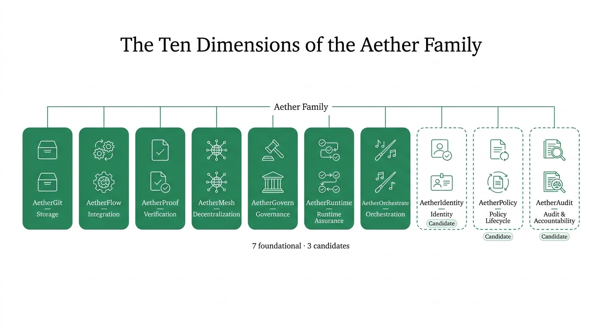
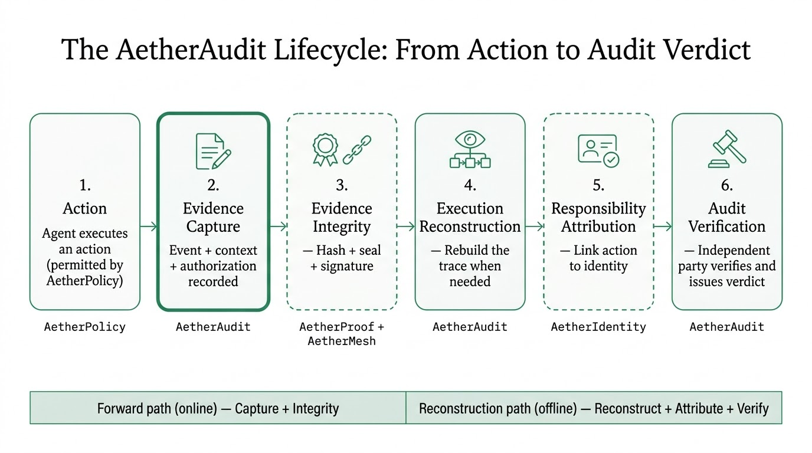
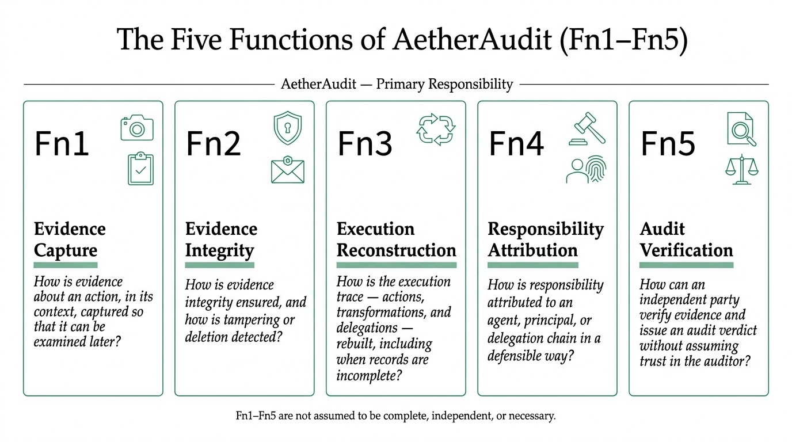
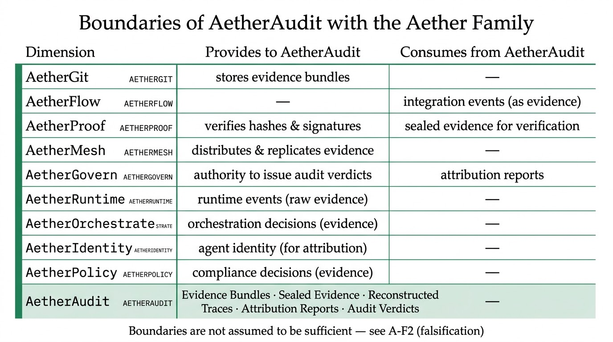
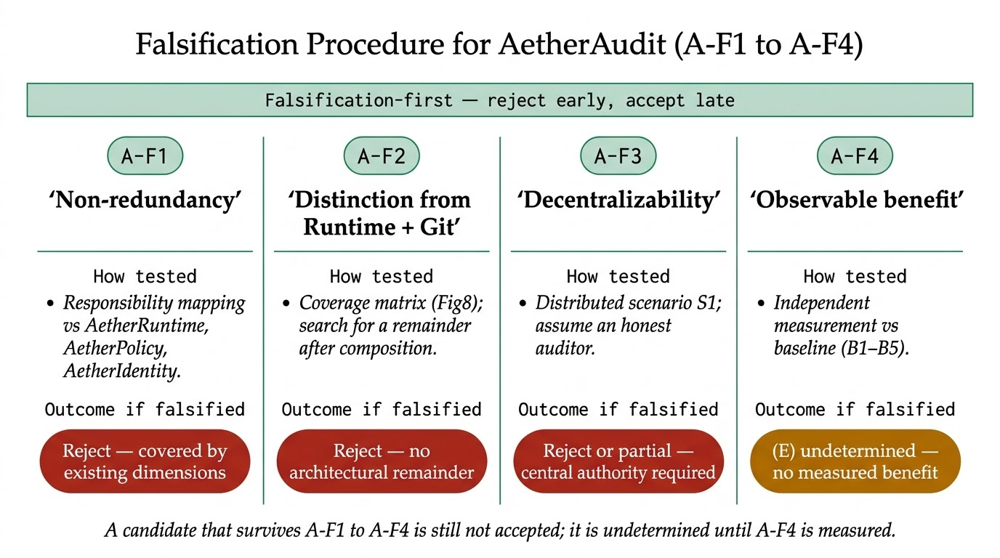
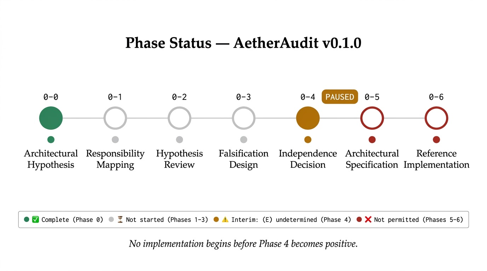
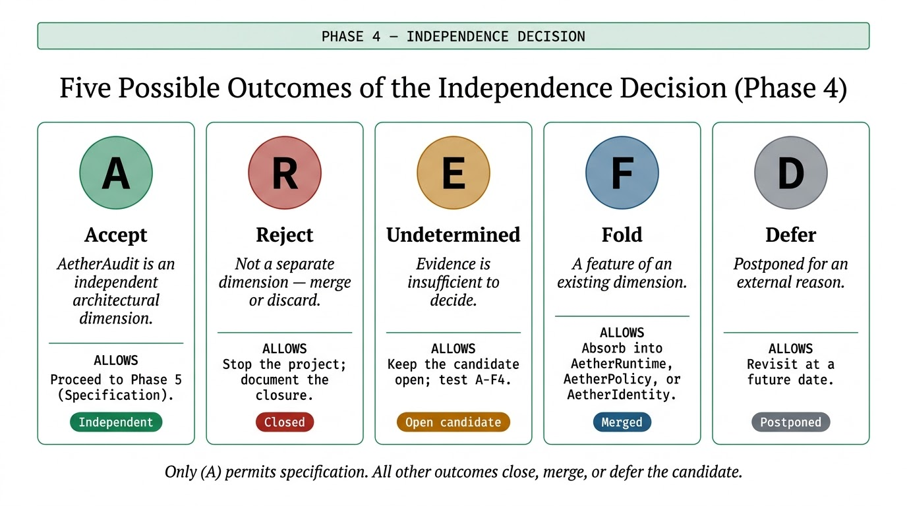
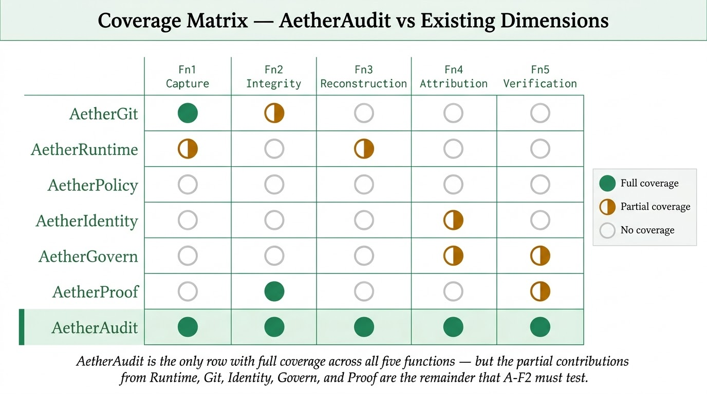
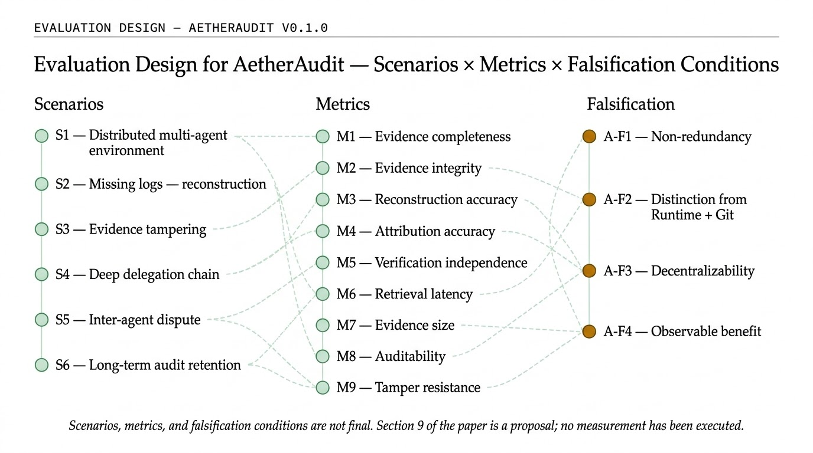

# 🛡️ AetherAudit — Research Repository

### Verifiable Evidence and Accountability Infrastructure for Autonomous Agent Systems

*A Falsification-First Investigation of Audit, Evidence, and Responsibility in Decentralized Multi-Agent Systems*

---

[](https://doi.org/10.5281/zenodo.24274628)
[](https://doi.org/10.6084/m9.figshare.35023519)
[](https://creativecommons.org/licenses/by/4.0/)
[](https://orcid.org/0009-0003-8903-0029)
[]()
[]()
[-amber)]()
[](https://aetheraudit.netlify.app)

---

> **Status: Architectural Investigation.**
> This is a **research repository**, not a software repository.
> No implementation is planned unless the architectural investigation supports it.
> **Decision: (E) undetermined (interim).**
> See [`DECISIONS/INDEPENDENCE_DECISION.md`](DECISIONS/INDEPENDENCE_DECISION.md).

> *"AetherAudit is a candidate, not a result."*

---

## Table of Contents

- [Overview](#overview)
- [Central Question](#central-question)
- [Five Functions](#five-functions-initial-scope)
- [Failure Conditions](#failure-conditions-a-f1-to-a-f4)
- [Propositions](#propositions-p1-p2)
- [Decision (Phase 4)](#decision-phase-4)
- [Repository Structure](#repository-structure)
- [Phase Status](#phase-status)
- [What This Repository Does Not Claim](#what-this-repository-does-not-claim)
- [Related Aether Projects](#related-aether-projects)
- [Figures](#figures)
- [Research Status](#research-status)
- [Author](#author)
- [License](#license)

---

## Overview

**AetherAudit** is the **tenth project (candidate)** of the Aether family. It investigates whether a decentralized audit gap genuinely exists between runtime monitoring (AetherRuntime), policy enforcement (AetherPolicy), and identity (AetherIdentity).

**AetherAudit is not a replacement for AetherIdentity** (the eighth project) or **AetherPolicy** (the ninth project). Both remain candidates with unresolved independence.

This repository is a **research repository**. It contains no `src/`, no `tests/`, no `experiments/`. It will not contain them unless the investigation concludes that AetherAudit is independent.

**The paper (v1.0.0) is published on Zenodo:** [10.5281/zenodo.24274628](https://doi.org/10.5281/zenodo.24274628).
**Mirror on Figshare:** [10.6084/m9.figshare.35023519](https://doi.org/10.6084/m9.figshare.35023519).

---

## Central Question

> How can operational evidence be produced, kept intact, and used to reconstruct what actually happened and attribute responsibility — in decentralized autonomous agent systems — independently of runtime monitoring and policy enforcement?

The central question has four clauses, mapping to the failure conditions:

| Clause | Condition |
|---|---|
| (i) Not already covered by monitoring or policy | A-F1 |
| (ii) Does not decompose into AetherRuntime + AetherGit | A-F2 |
| (iii) No central audit authority | A-F3 |
| (iv) Observable benefit | A-F4 |

A positive answer needs all four. A negative answer on any one is sufficient to reject the candidate.

---

## Five Functions (Initial Scope)

The paper labels the functions **Fn1–Fn5**.

| # | Function | Question |
|---|---|---|
| **Fn1** | Evidence Capture | How is evidence about an action, in its context, captured so that it can be examined later? |
| **Fn2** | Evidence Integrity | How is evidence integrity ensured, and how is tampering or deletion detected? |
| **Fn3** | Execution Reconstruction | How is the execution trace — actions, transformations, and delegations — rebuilt, including when records are incomplete? |
| **Fn4** | Responsibility Attribution | How is responsibility attributed to an agent, principal, or delegation chain in a defensible way? |
| **Fn5** | Audit Verification | How can an independent party verify evidence and issue an audit verdict without assuming trust in the auditor? |

These five are **not** assumed to be complete, independent, or necessary.

---

## Failure Conditions (A-F1 to A-F4)

| ID | Claim under test | Status |
|:-:|---|:-:|
| **A-F1** | Non-redundancy: not covered by Runtime / Policy / Identity | 🟡 Not falsified (author's reading of own records) |
| **A-F2** | Distinction from Runtime + Git (a remainder survives) | 🟡 Not falsified (remainder may be small) |
| **A-F3** | Decentralizability: no central audit authority | 🟡 Not falsified (residuals: revocation window, honest auditor) |
| **A-F4** | Observable benefit | 🔴 **Untested** |

> **"Not falsified" is a weaker status than "confirmed". "Untested" is not a pass.**
> The decision rule: the candidate is accepted as an independent dimension only if all four conditions have been tested and none falsified, with A-F4 supported by measured results. With three conditions not falsified by argument alone and one untested, the third case applies: **(E) undetermined**.

---

## Propositions P1–P2

| # | Proposition | Status |
|:-:|---|---|
| **P1** | Determinism of audit reconstruction | Proof sketch (near-trivial; content in the purity conditions) |
| **P2** | Irreducible trust anchor in audit verification | Proof sketch (symmetry argument; cuts against independence) |

**P1** is close to trivial: it says that a pure function of its inputs is a function of its inputs. Its content is in the conditions of completeness and intactness, which real systems can violate.

**P2** states that any deterministic, interactive audit-verification procedure rests on a trust anchor that the evidence itself cannot supply: a decision about standing. The anchor is plausibly a governance matter. This cuts **against** independence.

Neither is machine-checked.

---

## Decision (Phase 4)

**AetherAudit is classified as (E) undetermined (interim).**

The evidence is insufficient to accept AetherAudit as an independent dimension, and insufficient to reject it. A test is needed to decide. See [`DECISIONS/INDEPENDENCE_DECISION.md`](DECISIONS/INDEPENDENCE_DECISION.md).

**Why insufficient to accept:**
- A-F4 is untested: no benefit has been observed.
- A-F2 remainder may be small.
- A-F3 has residuals (revocation window, honest auditor).
- The propositions are small (P1 near-trivial; P2 cuts against independence).
- AetherIdentity, which supplies one of the inputs, is itself unresolved.

**Why insufficient to reject:**
- No failure condition has been falsified.
- The comparison found a remainder after composition with the neighbours (A-F2).
- The decentralization argument did not reach a requirement for a central decision point (A-F3).
- The rejection would rest on the same author's reading that is here judged insufficient to accept.

**"Undetermined" is not a failure.** It states that the evidence is insufficient to decide, and names what is missing.

---

## Repository Structure

```text
AetherAudit/
│
├── README.md
├── ARCHITECTURAL_HYPOTHESIS.md
├── ROADMAP.md
├── CHANGELOG.md
├── PROJECT_SUMMARY.txt
├── CITATION.cff
├── AUTHORS.md
├── CONTRIBUTING.md
├── INVENTORY.md
├── VERSION
├── manifest.json
├── scientific_state.json
├── netlify.toml
├── LICENSE
│
├── research/
│   └── RESPONSIBILITY_BOUNDARIES.md
│
├── FALSIFICATION/
│   └── FALSIFICATION_PLAN.md
│
├── DECISIONS/
│   └── INDEPENDENCE_DECISION.md
│
├── REVIEW/
│   └── INTERNAL_REVIEW.md  (internal, not independent)
│
├── REFERENCES/
│   └── (to be populated with references from the paper)
│
├── docs/
│   └── figures/
│       ├── Fig1_Nine_Dimensions.png
│       ├── Fig2_Audit_Lifecycle.png
│       ├── Fig3_Audit_Functions.png
│       ├── Fig4_Boundaries.png
│       ├── Fig5_Falsification_Procedure.png
│       ├── Fig6_Phase_Status.png
│       ├── Fig7_Decision_Outcomes.png
│       ├── Fig8_Overlap_Matrix.png
│       └── Fig9_Evaluation_Design.png
│
├── paper/
│   └── AetherAudit_Research_Paper_v1.0.0.md
│
├── PUBLICATION/
│   └── Netlify/
│       └── public/
│           ├── index.html
│           ├── dashboard.html
│           ├── reports.html
│           ├── documentation.html
│           ├── robots.txt
│           ├── sitemap.xml
│           └── _headers
│
└── REPORTS/
    └── architectural_investigation/
        └── investigation_report.md
```

No src/, no tests/, no experiments/.

---

Phase Status

Phase Description Status
0 — Architectural Hypothesis The hypothesis is stated ✅ Complete (ARCHITECTURAL_HYPOTHESIS.md)
1 — Responsibility Mapping Boundaries with existing dimensions ⏳ Not started (research/RESPONSIBILITY_BOUNDARIES.md)
2 — Hypothesis Review Independent review of hypothesis ⏳ Not started (REVIEW/INDEPENDENT_REVIEW.md)
3 — Falsification Design Design of A-F1 to A-F4 tests ⏳ Not started (FALSIFICATION/FALSIFICATION_PLAN.md)
4 — Independence Decision (E) undetermined (interim) ⚠️ Interim (DECISIONS/INDEPENDENCE_DECISION.md)
5 — Architectural Specification Requires positive Phase 4 ❌ Not permitted
6 — Reference Implementation Requires Phase 5 ❌ Not permitted

---

What This Repository Does Not Claim

· That AetherAudit is an independent architectural dimension.
· That the five functions are complete, independent, or necessary.
· That the boundaries with AetherRuntime, AetherPolicy, AetherIdentity, and the other dimensions are sufficient.
· That the gap is genuine.
· That implementation should begin.
· Any observed benefit (A-F4 is untested).
· Any causal effect.

---

Related Aether Projects

# Project Status DOI
1 AetherGit Foundational 10.5281/zenodo.23976986
2 AetherFlow Foundational 10.5281/zenodo.23979129
3 AetherProof Foundational 10.5281/zenodo.24013124
4 AetherMesh Foundational 10.5281/zenodo.24038038
5 AetherGovern Foundational 10.5281/zenodo.24054524
6 AetherRuntime Foundational 10.5281/zenodo.24078477
7 AetherOrchestrate Foundational 10.5281/zenodo.24095399
8 AetherIdentity Candidate (paper + v2.0.0) 10.5281/zenodo.24102739
9 AetherPolicy Candidate (paused at Phase 4) 10.5281/zenodo.24160047
10 AetherAudit Candidate (this repository) 10.5281/zenodo.24274628

---

## Figures

| # | Figure | Description |
|---|--------|-------------|
| 1 |  | The nine dimensions of the Aether family, with AetherAudit as candidate #10 |
| 2 |  | The AetherAudit lifecycle (Action → Capture → Integrity → Reconstruction → Attribution → Verification) |
| 3 |  | The five functions of AetherAudit (Fn1–Fn5) |
| 4 |  | AetherAudit and its boundaries with the seven foundational dimensions |
| 5 |  | The falsification procedure (A-F1 to A-F4) |
| 6 |  | Phase status (paused at Phase 4) |
| 7 |  | The five Phase 4 outcomes (A / R / E / F / D) |
| 8 |  | Coverage matrix: five functions × existing dimensions |
| 9 |  | Evaluation design: scenarios × metrics × failure conditions |

Figures 1–9 are described in the paper.

---

Research Status

Item Status
Project AetherAudit — candidate tenth project of the Aether family; does not replace AetherIdentity or AetherPolicy
Phase Paused at Phase 4 (Independence Decision) — interim
Decision (E) Undetermined: insufficient to accept, insufficient to reject
Propositions P1 (near-trivial) and P2 stated as proof sketches; not machine-checked
Failure conditions A-F1, A-F2, A-F3 not falsified by argument; A-F4 untested
Implementation None
Experiments None executed; Section 9 of the paper is a proposal
Independent review Not started (Phase 2)
Claims not made Independence of the dimension; completeness of the five functions; sufficiency of the boundaries; any observed benefit; any causal effect

---

Author

Samir Baladi
Interdisciplinary AI Researcher, Ronin Institute / Rite of Renaissance

 
Email gitdeeper@gmail.com
ORCID 0009-0003-8903-0029
GitHub gitdeeper15/aetheraudit
GitLab gitlab.com/gitdeeper15/aetheraudit
Codeberg codeberg.org/gitdeeper15/aetheraudit
Bitbucket bitbucket.org/gitdeeper15/aetheraudit
Website aetheraudit.netlify.app
Zenodo 10.5281/zenodo.24274628

---

License

CC-BY-4.0 (this document). MIT (code, future — none in this release).

---

AetherAudit v1.0.0 — Architectural Investigation.
© 2026 Samir Baladi — Ronin Institute / Rite of Renaissance.
DOI: 10.5281/zenodo.24274628
